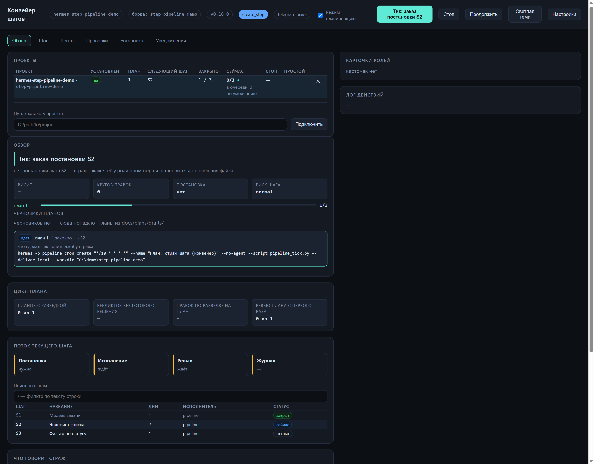

# step_pipeline — конвейер шагов для Hermes

Плагин, который доводит работу «по плану» до конца без вашего участия в каждом шаге.

Вы пишете план: что нужно сделать, разбитый на небольшие шаги. Дальше плагин сам
готовит задание на каждый шаг, отдаёт его агенту-исполнителю, отправляет результат
независимому ревьюеру и записывает итог в журнал. Шаг считается закрытым только тогда,
когда есть вердикт «принято» и настоящий коммит, — не на словах.

Конвейер идёт сам по расписанию, а вы в любой момент открываете локальную панель и
видите, где он сейчас.



---

## Зачем это нужно

Обычная работа с агентом выглядит так: «сделай следующее», потом «нет, не так»,
потом «а теперь проверь, что не сломал». Конвейер убирает этот разговор:

- **задачи не теряются** — они записаны в плане, а не в переписке;
- **каждый шаг проверяется дважды** — постановку смотрит один агент, результат другой;
- **шаг нельзя закрыть на словах** — только по вердикту и коммиту;
- **виден прогресс** — журнал и панель показывают, что сделано и что дальше;
- **вы решаете только важное** — утверждаете план, снимаете стоп, разбираете замечания.

## Как это работает

### Путь до первого шага

1. **План.** Вы просите агента составить план. Он раскладывает работу на шаги, у
   каждого — что сделать, какие файлы трогать, как проверить и что считается готовым.
   Черновик ложится в `docs/plans/drafts/` и сам в работу не идёт.
2. **Разведка.** Прежде чем писать своё, агент-разведчик ищет готовые решения:
   библиотеки, сервисы, подходы. Результат — короткая таблица с вердиктом по каждому
   кандидату: берём, форкаем или делаем своё.
3. **Правка и ревью плана.** План дополняется выводами разведки, затем отдельный агент
   проверяет его целиком: связность шагов, риски, соответствие правилам проекта.
   Правку по разведке и правку по замечаниям ревью заказывает страж карточками конвейера —
   вам остаётся утвердить план.
4. **Утверждение.** План утверждаете вы — командой или кнопкой в панели. Только после
   этого конвейер начинает работу.

### Дальше — по шагам

Для каждого шага конвейер делает одно действие за раз:

**постановка** → **исполнение** → **ревью** → **журнал** → следующий шаг

- постановщик пишет подробное задание: что именно сделать, где, чем проверить;
- исполнитель делает шаг и коммитит результат;
- ревьюер проверяет результат по контракту шага и выносит вердикт;
- страж читает вердикт и коммит, дописывает строку в журнал и заказывает следующий шаг.

Если ревьюер вернул замечания, исполнитель получает круг правок, затем ревью повторяется.
Кругов правок даётся столько, сколько стоит в `max_fix_rounds` проекта (по умолчанию два);
каждый новый отказ ревьюера — новая карточка правок, а не ревью того же текста. Когда
лимит исчерпан — конвейер останавливается и ждёт вашего решения. Это защита, а не поломка.

### Реестр находок плана

Замечания к плану живут не только в отчёте ревью: рядом с ним лежит реестр
`plan-N-findings.md` (каталог из `paths.reviews`, по умолчанию `docs/reviews/`). Это
таблица из шести колонок — ID, шаг, класс, находка, что сделать, статус.

Правило блокирования одно: план держит статус `открыто`, а `закрыто` и `не блокирует` — нет.
Класс ничего не блокирует, он выбирает маршрут, и называет его ревьюер: замысел и
двусмысленность — правка плана, формат стража — правка формулировки шага, стиль — примечание.
Это соглашение роли `pipeline-plan-reviewer`, ветки в коде у этих четырёх классов нет. Один
маршрут механический: находку класса `гейт-исполнение` страж не оставляет в плане, а кладёт в
карточку шага подсказкой «проверить при исполнении» — её предмет видно только на живом коде.
На вердикт это не влияет: вердикт считается по статусу, а не по маршруту.

Реестр сильнее отчёта: вердикт ревьюера сверяется с ним, и расхождение (утверждение при
открытых находках) называется вслух, а не сглаживается. Реестра нет — всё работает как
раньше, по тексту отчёта.

### Кто за что отвечает

| Кто | Что делает |
|---|---|
| вы | пишете и утверждаете план, снимаете стопы, решаете спорные случаи |
| агент-планировщик | раскладывает задачу на шаги и задаёт уточняющие вопросы |
| агент-разведчик | ищет готовые решения и оценивает их цену |
| агент-постановщик | пишет задание на шаг так, чтобы его можно было выполнить однозначно |
| агент-исполнитель | правит код и коммитит |
| агент-ревьюер | проверяет шаг независимо от исполнителя |
| страж (скрипт без модели) | читает файлы и решает, какое действие сделать следующим |

Главное отличие от «просто агента»: решения принимает скрипт. Агенты пишут код и
вердикты, а страж читает их с диска и не может уговорить себя закрыть шаг, которого
не было.

---

## Установка

Нужен установленный Hermes Agent и Python 3.11+. Внешние зависимости плагину не нужны.

### 1. Поставить плагин

Из Git (рекомендуется — так работают обновления):

```bash
# ставится только пакет step_pipeline/, без docs/ и tests/
hermes plugins install SMHotey/hermes-step-pipeline/step_pipeline
```

Или из скачанного архива репозитория:

```bash
./install.sh              # Linux и macOS
install.ps1               # Windows (PowerShell)
```

Скрипты копируют пакет в `plugins/step_pipeline` внутри каталога Hermes и выполняют
`hermes plugins enable step_pipeline`. Установка из Git идёт как «custom source»: на
чистом security-скане может появиться предупреждение о непроверенном источнике;
`--force` ставит копию осознанно.

Плагины в Hermes включаются **по профилям**: команда `hermes pipeline` есть только там,
где плагин включён. Мастер установки включает его в профиле драйвера сам, а если в этом
профиле каталога плагина ещё нет — связывает профиль с установленным пакетом. Для
остальных профилей, из которых вы работаете, включите вручную:
`hermes -p <профиль> plugins enable step_pipeline`.

### 2. Поставить конвейер в проект

```bash
cd C:/work/my-project
hermes pipeline setup
```

Мастер спросит:

1. **борду канбана** — где будут жить карточки ролей (обычно имя проекта);
2. **профиль исполнителя** — тот, который правит код;
3. **токен бота от @BotFather** — по желанию, можно пропустить;
4. **chat id** — можно ввести руками или написать боту `/start`, мастер поймает сам.

Дальше он сам скопирует в проект рабочие файлы и роли, создаст профили постановщика,
ревьюера и разведчика, заведёт расписание и добавит проект в доверенные. Профиль
разведки — четвёртая роль: без него карточка разведки уходит в профиль `scout`, которого
на чистой машине нет, и план остаётся без prior art.

Без вопросов, для скрипта или CI:

```bash
hermes pipeline setup --board myproj --driver myproj --no-telegram --yes
```

### 3. Проверить

```bash
hermes pipeline doctor     # ждём «ИТОГ: OK»
hermes pipeline status     # что видит страж
hermes pipeline ui         # открыть панель в браузере
```

`doctor` проверяет, что файлы и настройки на месте. Он не проверяет, что агенты
запускаются: это подтверждает только первая карточка, дошедшая до статуса `done`.

### Обновление

```bash
hermes pipeline update --check   # что стоит и что вышло
hermes pipeline update           # поставить последний релиз
```

Мастер установки также заводит ежедневную проверку обновлений. После обновления
плагина обновите рабочие файлы в проектах:

```bash
hermes pipeline setup --upgrade
```

Ставится архив тега с GitHub; прежняя копия плагина уезжает в
`<hermes_home>/plugin-backups/`, прежние версии ролей в проекте — в
`.pipeline/roles-backup/`. Панель сама показывает в шапке, что вышел новый релиз.
Движок в проектах плагин молча не переписывает: это отдельное осознанное действие.

Проверка идёт анонимно, поэтому работает для публичного репозитория. Если копия
плагина ведёт на private-репозиторий, положи в `.env` профиля `GITHUB_TOKEN`
(достаточно прав на чтение) — без него GitHub отвечает 404, и обновление молчит.

---

## Первый план целиком

1. Убедитесь, что режим планировщика включён (он включён по умолчанию):

   ```bash
   hermes pipeline plan-mode status
   ```

2. Попросите агента: «составь план …». Он задаст до пяти вопросов, запишет допущения
   и положит черновик в `docs/plans/drafts/`.

3. Проверьте черновик:

   ```bash
   hermes pipeline plan --check 1
   ```

4. Утвердите план — командой или кнопкой **«Утвердить»** в блоке «Черновики планов»
   на вкладке «Обзор»:

   ```bash
   hermes pipeline plan --accept 1
   ```

   Утверждение привязывается к текущему содержимому файла. Если план потом изменить,
   его нужно утвердить заново — так правка не уедет в работу незамеченной.

   Переутверждение заодно открывает новый бюджет кругов правок плана (лимит —
   `max_fix_rounds` проекта, по умолчанию два). Иначе после стопа «круги правок плана
   исчерпаны — решает владелец» правка плана
   ничего бы не меняла: следующий тик упирался бы в те же исчерпанные круги.

5. Запустите один шаг вручную, если не хотите ждать расписания:

   ```bash
   hermes pipeline run
   ```

Дальше конвейер идёт сам. Панель покажет, где он остановился и что нужно от вас.

---

## Панель

```bash
hermes pipeline ui --detach   # поднять в фоне
hermes pipeline ui --stop     # погасить
```

Порт по умолчанию — 8770. Переопределяется ключом `ui_port` в `pipeline.json` проекта
или флагом `--port`; флаг сильнее конфига.

```bash
hermes pipeline ui --port 8899 --no-open
hermes pipeline config --set ui_port 8899
```

Панель слушает только ваш компьютер (localhost) и не требует пароля: это пульт
владельца, а не сетевой сервис.

Что там есть:

- **Обзор** — что делает страж прямо сейчас, прогресс по планам, черновики планов,
  кнопки «Тик», «Стоп», «Продолжить» и «Утвердить»;
- **Шаг** — контракт выбранного шага, постановка, отчёт ревью, коммит;
- **Проверки** — диагностика установки и линтер планов;
- **Установка** — мастер для нового проекта;
- **Уведомления** — настройки Telegram;
- **События** — лента действий конвейера.

### Прогресс шага

Над таблицей шагов и в карточке шага видно, сколько пройдено:

- плитки этапов «Постановка → Исполнение → Ревью → Журнал» с процентом и полосой;
- в таблице шагов — колонка «Прогресс»: дорожка из четырёх сегментов (весь путь шага
  виден, не раскрывая его), полоса процента и остаток;
- у плитки «Ревью» — вердикт и счётчик находок (`3 находки · 1 блокир.`); если раздел
  «Находки» в отчёте не разобрался, стоит «?», а не ноль;
- остаток времени `~45 мин` с вилкой в подсказке (`22 мин — 1 ч 8 мин`) и основой счёта;
- круг правок рисуется отдельным отрезком и не откатывает общий процент: правки — это
  добавленная работа, а не отменённая.

Процент считается по этапам, а не по строкам кода: движок не знает, «наполовину ли
написан» шаг. Веса этапов (10/55/25/10) учатся по медианам длительности, как только
в плане набралось три замера на этап; порог и веса задаются в `pipeline.json`:

```json
{"ui": {"progress": {"learn": true, "min_samples": 3,
                     "weights": {"prompt": 10, "step": 55, "review": 25, "journal": 10}}}}
```

Тумблер «Режим планировщика» наверху запрещает или разрешает агенту писать новые
планы в этом проекте.

Посмотреть на чужой проект, ничего в него не записывая:

```bash
hermes pipeline ui --project C:/work/proj --preview --board <борда>
```

В предпросмотре действия выключены — панель только читает.

**Остановить всё после шага.** Кнопка «Остановить после шага» в шапке панели ставит
стоп-флаг всем открытым планам всех проектов реестра: текущие шаги доигрываются, новые
не начинаются. Когда флаги стоят у всех, кнопка становится «Запустить всё» и снимает
свои флаги (инцидентные не трогает — их снимает страж). Как только закрылась последняя
карточка в работе, приходит сообщение «Все проекты на паузе» в Telegram и всплытие в
браузере. Состояние кнопки хранится в реестре панели и переживает перезагрузку страницы.
Жест выполняется в фоне (движок может ждать текущий шаг): кнопка сразу показывает
«Пауза выполняется…», а повторное нажатие до конца работы отклоняется.

**Автозагрузка.** В «Настройках» есть чекбокс «запускать панель при входе в систему»:
Windows — задача планировщика `Pipeline_Panel` со скрытым запуском, Linux — запись в
`~/.config/autostart`, macOS — LaunchAgent. Чекбокс показывает реальное состояние
системы, а не то, что кто-то когда-то записал в конфиг.

---

## Telegram-уведомления (необязательно)

Уведомления приходят о старте шага, принятом ревью, инциденте и исчерпании кругов
правок. Молчание между событиями — норма, а не поломка.

Токен бота хранится только в `.env` профиля Hermes и в панели не показывается.
Быстрая проверка канала:

```bash
hermes pipeline notify-test
```

Если `api.telegram.org` в вашей сети недоступен, конвейер умеет ходить через прокси:
адрес берётся из `STEP_PIPELINE_TELEGRAM_API_BASE`, а если его нет — из общего ключа
Hermes `TELEGRAM_API_BASE_URL`. Готовый воркер и порядок настройки —
[docs/TELEGRAM-PROXY.md](docs/TELEGRAM-PROXY.md).

Владелец может управлять конвейером прямо из чата: `/status`, `/plans`, `/stop`,
`/resume`, `/help`. Команды принимает только настроенный чат.

---

## Настройки проекта

Все настройки проекта живут в одном файле — `pipeline.json` в корне. Менять их можно
командой:

```bash
hermes pipeline config --get paths.plans
hermes pipeline config --set runtimes.step 5h
hermes pipeline config --set ui_port 8899
```

Что чаще всего нужно:

| Ключ | Зачем |
|---|---|
| `driven_plans` | какие планы ведёт конвейер: `["*"]` — все |
| `runtimes.step` | сколько времени даётся исполнителю на шаг |
| `ui_port` | порт панели (по умолчанию 8770) |
| `require_prompt` | не начинать шаг без постановки (по умолчанию включено) |
| `max_plan_growth` | допуск роста плана при правке по ревью: проценты от объёма и знаки на каждую закрытую находку; сверх допуска — остановка и решение владельца |
| `ui.progress` | веса этапов и порог обучения для процентов и остатка времени в панели |

`driven_plans` и `profiles` меняет только владелец: шаг конвейера их не трогает. Мастер
установки спрашивает имена ролей и пишет их сам — включая `profiles.scout` (профиль
разведки; без ключа движок берёт профиль с именем `scout`).

Формат плана, который конвейер читает, описан отдельно —
[docs/PLAN-FORMAT.md](docs/PLAN-FORMAT.md). Готовый образец для копирования —
`step_pipeline/templates/plan-template.md`.

### Режим планировщика

Включён по умолчанию: агент планирует по протоколу, а утверждает план владелец.

```bash
hermes pipeline plan-mode status   # «Режим планировщика: on|off»
hermes pipeline plan-mode on|off   # переключить (действует со следующей сессии)
```

При выключенном режиме загрузка скилла планирования блокируется — агент не начнёт
придумывать планы там, где это не нужно.

---

## Если что-то пошло не так

Начните с двух команд:

```bash
hermes pipeline status      # что конвейер делает и чего ждёт
hermes pipeline doctor      # установка, движок, борда, расписание, Telegram
```

Дальше по ситуации:

- **карточки не двигаются** — `hermes kanban --board <борда> ls` покажет их статусы;
- **шаг встал** — `hermes pipeline status` называет причину и одно действие;
- **панель не открывается** — проверьте, не занят ли порт: `hermes pipeline ui --port 8899`;
- **агент не стартует** — чаще всего не сохранён ключ модели в профиле роли или роль не
  доверяет проекту; установщик делает это сам, но при ручных правках стоит проверить;
- **лог фоновой панели** — `.pipeline/ui.log`.

Стопы бывают двух видов: **инцидентный** снимается сам, когда причина исчезла, а
**владельческий** («остановиться после шага») — только кнопкой «Продолжить». Это
сделано намеренно: решение человека не должно теряться.

---

## Инструменты для агента

Конвейер доступен агенту в любой сессии, поэтому «продолжай план» работает без
пересказа контекста:

| Инструмент | Что делает |
|---|---|
| `pipeline_status` | снимок: планы, шаги, карточки, решение стража |
| `pipeline_run` | один тик: заказ постановки, карточка шага, ревью, закрытие |
| `pipeline_control` | `stop`, `resume`, `hold`, `unhold` |

---

## Безопасность и секреты

- Секреты живут только в `.env` профиля Hermes; в коде, логах и панели их нет.
- `.pipeline/state/` и `.pipeline/.env` добавляются в `.gitignore` проекта.
- Исходящие запросы: `api.telegram.org` (уведомления), `api.github.com` и `github.com`
  (проверка релиза и загрузка архива при обновлении).
- Внешних зависимостей нет: Python stdlib и Hermes.

---

## Для разработчика

Плагин — чистый Python без сборки.

```
step_pipeline/
  plugin.yaml        манифест: версия, инструменты, схема настроек
  cli.py             команды `hermes pipeline …`
  setup_flow.py      мастер установки и обновления проекта
  snapshot.py        снимок состояния для панели и инструментов агента
  ui_server.py       локальный HTTP-сервер панели
  ui/index.html      панель (один файл, без сборки)
  engine/            движок, который копируется в проект как `.pipeline/`
  roles/             скиллы ролей (копируются в `.hermes/skills/`)
  templates/         образцы плана, промта и `pipeline.json`
tests/
  test_*.py          тесты плагина
  engine/            тесты движка отдельным слоем
```

Важное правило: движок правится только в `step_pipeline/engine/`. В проектах лежит
его копия в `.pipeline/`, и обновляет её `hermes pipeline setup --upgrade`. Правки
внутри проекта при следующем обновлении будут перезаписаны.

Проверки перед коммитом:

```bash
python -m pytest                        # все тесты
hermes plugins validate step_pipeline   # манифест, инструменты, security-скан
```

Подробности архитектуры и принятые решения — [docs/CONTEXT.md](docs/CONTEXT.md),
история версий — [CHANGELOG.md](CHANGELOG.md).

### Основные команды

```bash
hermes pipeline setup [--upgrade]        # установка или обновление в проекте
hermes pipeline status [--json]          # состояние и решение стража
hermes pipeline run                      # один тик вручную
hermes pipeline ui [--detach|--stop]     # панель
hermes pipeline doctor [--plan N]        # диагностика и проверка планов
hermes pipeline plan --list|--check|--accept
hermes pipeline plan-mode status|on|off
hermes pipeline notify-test
hermes pipeline config --get|--set
hermes pipeline update [--check]
```

Проект ищется вверх от текущего каталога по `pipeline.json`; можно указать явно:
`--project <путь>` или переменную `PIPELINE_REPO`.

---

## Удаление

```bash
hermes plugins disable step_pipeline
hermes plugins remove step_pipeline
```

Движок, скопированный в проект, продолжает работать сам:
`python .pipeline/gate.py --run`.

## Лицензия

MIT — полный текст в [LICENSE](LICENSE). Плагин можно свободно использовать, менять и
распространять, сохраняя строку копирайта. Гарантий автор не даёт.
